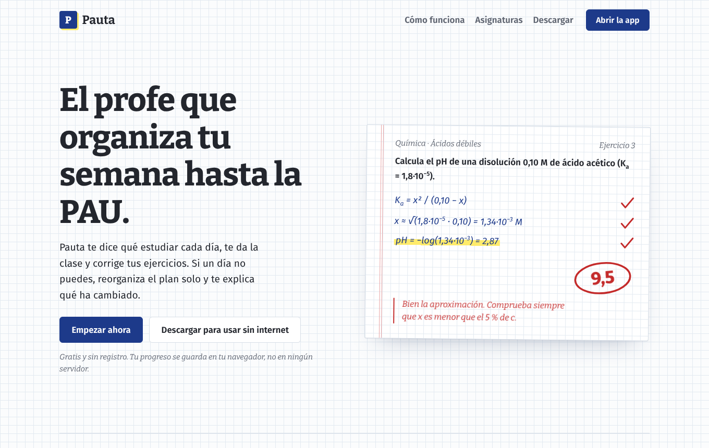
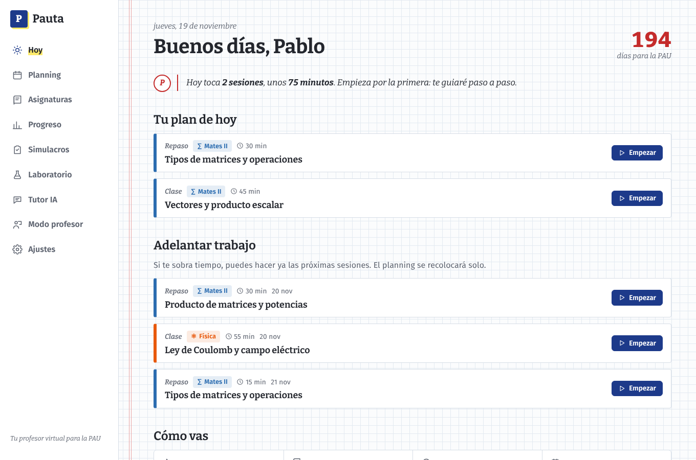

# Pauta — tu profesor virtual para la PAU

> 🇬🇧 [Read in English](README.md)

**Pauta** es un profesor virtual que organiza tu semana y te da una clase guiada cada día para preparar **Física** y **Matemáticas II** de la PAU de la Comunitat Valenciana.

Le dices qué asignaturas estudias, cuánto tiempo tienes y cuándo es tu examen. Pauta crea un **planning semanal adaptable**, te da clase paso a paso (teoría → ejemplo resuelto → práctica guiada con pistas → mini test → resumen) y **replanifica solo** cuando faltas un día, un tema se te atraganta o añades una asignatura. Además, te explica qué ha cambiado y por qué.





## Cómo usarla

| Opción | Cómo |
|---|---|
| 🌐 **Web** | Entra en `https://campayoo.github.io/EBAUTrainer`: verás la portada, y la app está en `/app/` (cuando esté publicada, ver [docs/despliegue.md](docs/despliegue.md)) |
| 💻 **Instalarla como app** | En Chrome o Edge, menú ⋮ → **Instalar Pauta**. Se abre en su propia ventana y funciona sin internet |
| 📦 **Descargarla** | Descarga **`Pauta.html`** (desde *Ajustes* en la web o desde *Releases* en GitHub) y ábrela con doble clic. Es un único archivo con todo dentro |

Tu progreso se guarda en tu navegador. Desde **Ajustes** puedes exportar una copia de seguridad para pasarla a otro ordenador.

## Funcionalidades

- **Bienvenida conversacional**: asignaturas, nivel, prueba inicial opcional, días y horas, fecha de examen y nota objetivo.
- **Planning automático**: intercala asignaturas, respeta los prerrequisitos (determinantes antes que sistemas con parámetros), reparte el temario, añade repasos espaciados (SM-2), refuerzos y simulacros al final. Se exporta a Google Calendar u Outlook (`.ics`).
- **Replanificación automática** al faltar, al ir mal o bien, o al cambiar asignaturas, horario o fecha. El profesor explica cada cambio.
- **Cinco asignaturas de la PAU valenciana, 97 unidades**: Matemáticas II (30), Física (25), Química (15), Biología (14) y Matemáticas Aplicadas a las CC. SS. II (13), todas con clase completa: teoría, ejemplo resuelto, práctica, test y resumen. 105 generadores de ejercicios.
- **«¿Por dónde vas en clase?»**: en la bienvenida (y luego en Asignaturas) marcas lo que ya habéis dado en el instituto; Pauta no te lo vuelve a explicar, te pone repasos espaciados y empieza por la siguiente unidad.
- **Diseño propio**: tu cuaderno de cuadrícula corregido por el profe (tinta azul, boli rojo, fosforito; modo oscuro de pizarra). Ver [docs/diseno.md](docs/diseno.md).
- **Clase diaria guiada**, con pistas en 3 niveles y solución paso a paso.
- **Corrección automática** con tolerancia, unidades (km/s ↔ m/s, N/kg ↔ m/s²) y **diagnóstico del error más probable**.
- **66 generadores de ejercicios** con parámetros aleatorios: todas las unidades del temario tienen práctica.
- **Simulacros cronometrados** con la estructura de la PAU valenciana, nota estimada y análisis de errores.
- **Progreso**: porcentaje por asignatura, bloque y unidad, puntos débiles, racha, cumplimiento y gráficas.
- **Laboratorio**: campos gravitatorio y eléctrico, MAS, y función y derivada.
- **Tutor IA opcional** (API de Claude, con tu propia clave) que da pistas en lugar de soluciones.
- **Modo profesor** sin servidor: los alumnos exportan su informe y el docente lo carga.
- Modo oscuro, diseño responsive y accesibilidad básica.

## Para desarrolladores

```bash
node tools/serve.mjs     # arrancar sin instalar nada → http://localhost:5173
npm install              # herramientas de desarrollo (esbuild, eslint, yaml)
npm test                 # 45 tests (incluye tests de propiedades del planificador)
npm run lint             # ESLint
npm run build:content    # validar content/ y regenerar el módulo de contenido
npm run build            # dist/Pauta.html (un archivo) y _site/ (GitHub Pages: portada + app/)
```

## Documentación

- [Estado del proyecto](docs/estado-del-proyecto.md): qué está hecho, qué falta y qué puede fallar.
- [Arquitectura](docs/arquitectura.md), [modelo de datos](docs/modelo-datos.md) y [formato del contenido](docs/formato-contenido.md).
- [Decisiones de arquitectura (ADR)](docs/adr/).
- [Cómo publicarla en GitHub Pages](docs/despliegue.md).
- [Guion para presentarla en una entrevista](docs/guion-entrevista.md).

## Licencia

Código: [MIT](LICENSE). Contenido educativo: [CC BY-SA 4.0](content/LICENSE). Todos los ejercicios son originales; los exámenes oficiales solo se enlazan.

Autor: **Pablo Campayo Viñes**. Técnico en SMR y estudiante de DAM (IES Abastos, Valencia).
