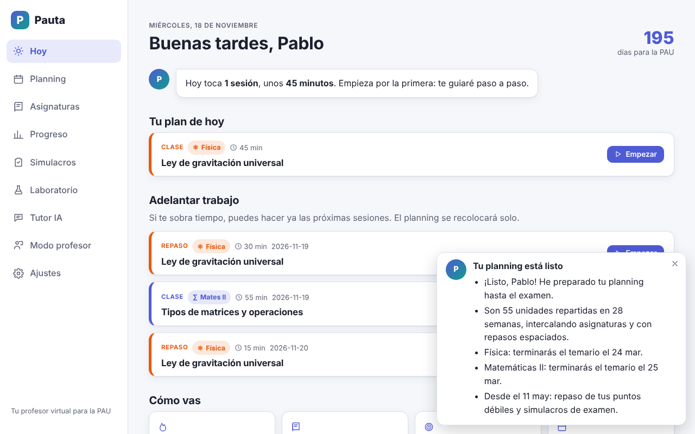

# Pauta — your virtual teacher for the Spanish university entrance exam (PAU)

> 🇪🇸 [Leer en español](README.es.md)

**Pauta** is a virtual teacher that plans your week and gives you a guided class every day to prepare **Physics** and **Mathematics II** for the PAU (Valencian Community, Spain).

You tell it which subjects you study, how much time you have and when your exam is. It builds an **adaptive weekly plan**, teaches each unit step by step (theory → worked example → guided practice with progressive hints → quiz → summary), and **re-plans automatically** when you miss a day, struggle with a topic or add a new subject. It also explains what changed and why.



**Use it:** online at `campayoo.github.io/EBAUTrainer` once published ([how](docs/despliegue.md)), installed as an app (Chrome/Edge → *Install Pauta*), or download `Pauta.html` (a single file that works offline: just double-click it).

## Features

- 🧑‍🏫 **Conversational onboarding**: subjects, level, optional placement quiz, availability, exam date and target grade.
- 📅 **Automatic, adaptive weekly plan**: interleaves subjects, respects prerequisites, paces the syllabus, adds spaced repetition (SM-2), reinforcement sessions and mock exams in the final weeks. Exports to calendar (`.ics`).
- 📖 **Full PAU syllabus**: 55 units (30 Maths II + 25 Physics), every one with a complete lesson: theory, worked example, practice, quiz and summary.
- 📚 **Daily guided class** with a fixed structure and 3-level hints (idea → method → first step → full solution).
- ✅ **Automatic grading** of numeric answers with tolerance, **unit conversion** (km/s ↔ m/s, N/kg ↔ m/s²) and **diagnosis of the most likely mistake** (wrong sign, powers of ten, using *h* instead of *R + h*...).
- 🎲 **66 parametrised exercise generators** (seeded): every unit of the syllabus can be practised, and solutions are computed in code.
- 📝 **Timed mock exams** with the real PAU structure (sections, points and choice between two options), plus an estimated grade and error analysis.
- 📈 **Progress & statistics**: per subject/block/unit, weak points, streak, plan compliance and charts.
- 🔬 **Interactive lab**: gravitational/electric fields, simple harmonic motion, and a function with its derivative.
- 🤖 **Optional AI tutor** (Claude API, bring your own key) that gives hints instead of answers.
- 👩‍🏫 **Teacher mode** without a server: students export a report and the teacher loads them in the browser.
- 🌙 Dark mode, responsive design, keyboard navigation and screen-reader labels. **Installable PWA** that works offline.

## Tech stack and why

| | |
|---|---|
| **App** | Vanilla JavaScript (ES modules), no framework and no mandatory build step. GitHub Pages serves the repo as-is |
| **Content** | YAML files in `content/`, validated and compiled to `src/content/content.generated.js` |
| **Maths rendering** | KaTeX (vendored, works offline) |
| **Storage** | `localStorage` + JSON backup export/import |
| **Packaging** | esbuild bundles everything into one self-contained `Pauta.html` |
| **Quality** | Node's built-in test runner (41 tests, including property-based tests of the planner), ESLint, GitHub Actions CI |
| **Deploy** | GitHub Pages (Actions workflow) + GitHub Releases for the downloadable file |

See [docs/arquitectura.md](docs/arquitectura.md) and the decision records in [docs/adr/](docs/adr/).

## Run it

```bash
# No dependencies needed to run the app:
node tools/serve.mjs          # → http://localhost:5173

# Development
npm install                   # esbuild, eslint, yaml
npm test                      # unit + property-based tests
npm run lint
npm run build:content         # validate content/ and regenerate the content module
npm run build                 # → dist/Pauta.html (single file) and _site/ (GitHub Pages)
```

## Project structure

```
pauta/
├── index.html, manifest.webmanifest, sw.js   # web app + PWA
├── src/
│   ├── core/        # pure logic: planner, SM-2, grading, generators, lesson, exam, stats, ics
│   ├── data/        # state store, storage, content indexes
│   ├── ui/          # safe HTML templates, Markdown + KaTeX, components, SVG charts
│   ├── views/       # one module per screen
│   └── content/     # generated from content/*.yaml
├── content/         # educational content (YAML), one folder per subject
├── tests/           # node --test
├── tools/           # content validation, build, local server
├── vendor/katex/
└── docs/            # architecture, data model, content format, ADRs, screenshots
```

## Licence

Code: [MIT](LICENSE). Educational content: [CC BY-SA 4.0](content/LICENSE). All exercises are original; official past papers are only linked, never copied.

Author: **Pablo Campayo Viñes** — DAM student (IES Abastos, Valencia).
