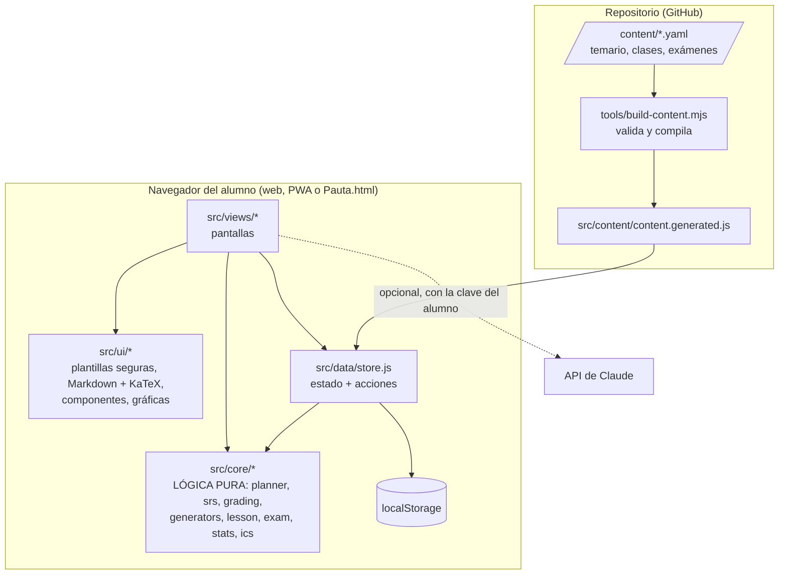
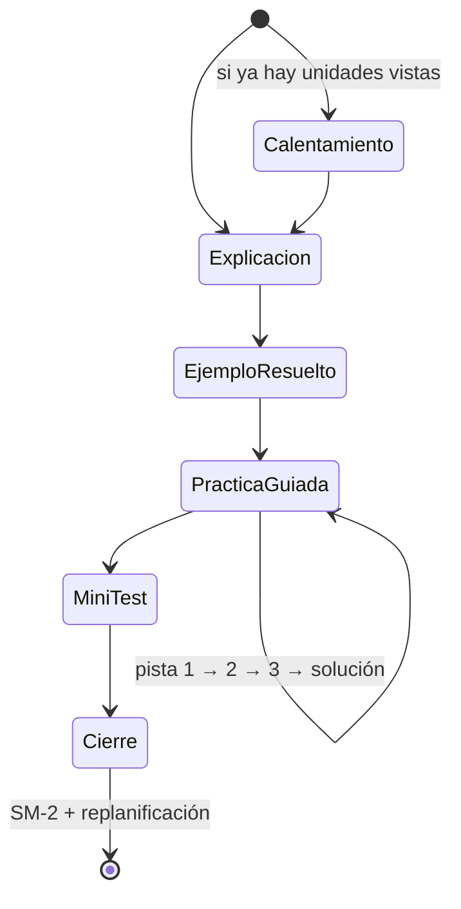
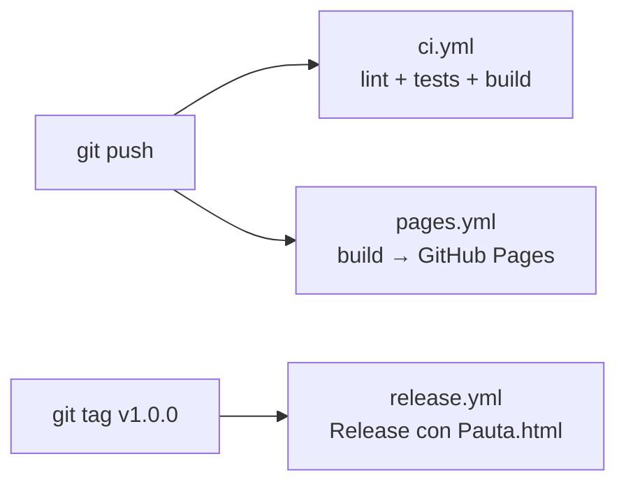

# Arquitectura

> Decisión de plataforma: ver [ADR-0002](adr/0002-web-estatica-github-pages.md).

## 1. Vista general



### Capas y por qué están separadas

| Carpeta | Qué contiene | ¿Depende del navegador? |
|---|---|---|
| `src/core/` | Planificador, repaso espaciado (SM-2), corrección de respuestas, generadores de ejercicios, máquina de estados de la clase, simulacros, estadísticas, exportación `.ics` | **No.** Son funciones puras: se testean con Node sin abrir ningún navegador |
| `src/data/` | `store.js` (estado y acciones), `storage.js` (localStorage y archivos), `content.js` (índices del temario) | Sí (localStorage) |
| `src/ui/` | `html.js` (plantillas que escapan el texto), `markdown.js` (Markdown + KaTeX), componentes, iconos y gráficas SVG | Sí |
| `src/views/` | Una vista por pantalla: `render()` devuelve HTML y `actions` responde a los clics | Sí |
| `content/` | El contenido educativo en YAML: añadir una asignatura no exige tocar el código | — |
| `tools/` | Validación y compilación del contenido, empaquetado (`build.mjs`) y servidor local | Node |

**Flujo de datos (unidireccional):** la vista llama a una acción → la acción crea un estado nuevo → se guarda → la vista se vuelve a dibujar. Es la misma idea que Redux o MVVM, pero en unas pocas líneas (`store.js`).

**Delegación de eventos:** en lugar de poner un listener en cada botón, `main.js` escucha una sola vez en la raíz y lee el atributo `data-action` del elemento pulsado. Por eso redibujar la pantalla no deja listeners "huérfanos".

## 2. El algoritmo de planning (`src/core/planner.js`)

```js
generatePlan(input) → { sessions, warnings, unscheduled, stats }
```

Es una **función pura**: misma entrada, mismo plan. Replanificar no es un caso especial: se vuelve a llamar con el estado nuevo y `diffPlans()` explica los cambios con las palabras del profesor.

1. **Orden válido**: ordenación topológica (algoritmo de Kahn) de las unidades según sus prerrequisitos. Si hay un ciclo, es un error del contenido y lo detecta el validador.
2. **Capacidad**: minutos disponibles por día hasta el examen. Las últimas semanas (15 %, entre 7 y 21 días) se reservan para repasos y simulacros.
3. **Demanda**: minutos de cada unidad × dificultad × peso de la asignatura × (1 − 0,4·dominio).
4. **Ritmo**: si sobra tiempo, las clases se reparten para acabar el temario hacia el 75 % de la fase de estudio, en lugar de verlo todo en un mes y quedarse meses sin nada.
5. **Cada día**, por este orden:
   - refuerzos de unidades que salieron mal;
   - repasos espaciados que tocan hoy;
   - clases nuevas, intercalando asignaturas: se elige la que va más "retrasada" respecto a su parte del total (las unidades largas se parten en trozos de al menos 25 min);
   - consolidación: si queda hueco, práctica de una unidad ya vista con mucho peso en el examen y poco dominio.
6. **Fase final**: un simulacro cada dos días (rotando asignaturas) y repaso de los puntos débiles.
7. **Avisos** si no da tiempo, con sugerencias.

**Tests** (`tests/planner.test.mjs`): casos concretos y **tests de propiedades** con 300 escenarios aleatorios que comprueban que siempre:
- nunca se supera el tiempo disponible de un día;
- una unidad nunca empieza antes que sus prerrequisitos;
- no hay sesiones después del examen ni identificadores repetidos;
- el plan es determinista.

## 3. Repaso espaciado (`src/core/srs.js`)

Algoritmo **SM-2**: tras cada sesión, la nota (0-1) se convierte en una calidad de 0 a 5. Si es buena, el intervalo hasta el siguiente repaso crece (1, 6, 6·EF días...); si es mala, vuelve a 1 día. También se calcula el **dominio** de cada unidad, que usa el planificador.

## 4. La clase diaria (`src/core/lesson.js`)



- **Clase completa**: la unidad tiene un YAML con teoría, ejemplo, práctica y test.
- **Clase exprés**: la unidad aún no tiene teoría escrita, pero sí generadores: práctica y test con ejercicios generados.
- **Estudio autónomo**: sin contenido ni generadores, el alumno estudia con sus materiales y se autoevalúa.

Nota = 40 % práctica + 60 % test. Cada pista resta un 25 %, cada intento fallido un 15 %, y ver la solución deja el ejercicio a 0.

## 5. Ejercicios y corrección

- **Generadores** (`src/core/generators/`): 66 plantillas con parámetros aleatorios y **semilla** (la misma semilla da el mismo ejercicio). La solución se calcula por código, así que siempre es coherente con los datos.
- **Corrección** (`src/core/grading.js`): entiende `8,69`, `6,67·10^-11`, `6.67e-11`, `10⁻¹¹`, `3/4`; compara con tolerancia; convierte unidades (12 km/s = 12 000 m/s; N/kg = m/s²); avisa si falta la unidad; y diagnostica el error más probable (errores previstos por el autor, signo, potencias de 10, factor 2 o 4).

## 6. Seguridad

| Riesgo | Medida |
|---|---|
| **XSS** (inyectar HTML o JavaScript) | Todo el texto pasa por `html\`\`` (`src/ui/html.js`), que lo escapa; el Markdown del contenido también se escapa antes de convertirlo. Los informes importados en modo profesor se validan y se recortan |
| Archivos importados maliciosos | Copias de seguridad e informes: se comprueba el formato, el tamaño y los tipos de cada campo |
| Clave de la API | La pone cada usuario, se guarda solo en su navegador y nunca va al repositorio (`.gitignore` incluye `.env`) |
| Path traversal en el servidor local | `tools/serve.mjs` rechaza rutas fuera de la carpeta del proyecto |
| `eval` | Prohibido por ESLint en la app. Solo el validador de contenido (en build/test, nunca en el navegador) evalúa las expresiones `check` escritas en el propio repositorio |
| Datos personales | Nada sale del navegador. El informe para el profesor contiene lo mínimo (minimización de datos) |

## 7. CI/CD


