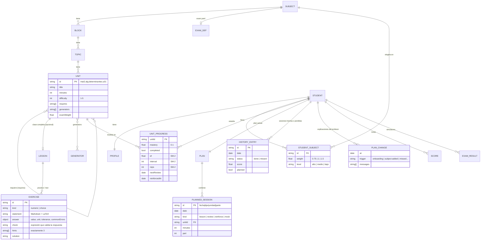

# Modelo de datos

Pauta no tiene base de datos en un servidor: todo el estado del alumno es **un objeto JSON** guardado en el `localStorage` del navegador (clave `pauta:v1`) y exportable como copia de seguridad. El contenido educativo es de solo lectura y viene compilado desde los YAML.

Aun así, el modelo está pensado como si fueran tablas. El día que se añada un backend, este diagrama se traduce casi directamente a SQL.

## Decisiones

1. **IDs de texto estables** (`mat2.alg.determinantes.u01`) en lugar de números autoincrementales. El contenido puede cambiar entre versiones; con IDs estables, el progreso del alumno sigue apuntando a la unidad correcta.
2. **Catálogo separado del estado.** Al actualizar la app cambia el contenido, pero el estado del alumno no se toca. `content.generated.js` lleva un hash (`version`) para saber si está al día.
3. **El plan se regenera, no se edita.** Las sesiones pasadas viven en `history` y las futuras en `plan`. Cada replanificación sustituye el plan y añade una entrada a `changes` con la explicación.
4. **El estado SM-2 se guarda junto al dominio** (`UNIT_PROGRESS`): una sola estructura por unidad.
5. **Los ejercicios generados no se guardan**: basta con `(generador, semilla)` para reconstruirlos.
6. **Migración**: `migrate()` en `store.js` completa los estados antiguos con valores por defecto, así que una copia de una versión anterior se puede seguir importando.
